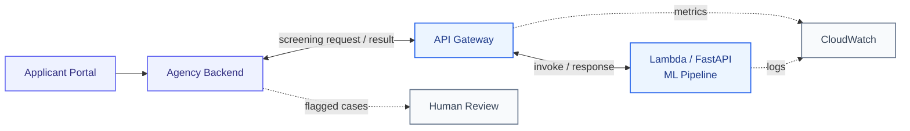
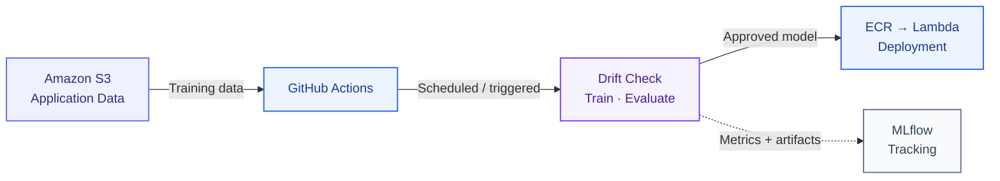

# System Architecture

## 1. Overview

A cloud-based fraud-detection system for a fictional
government agency processing financial assistance
applications.

The system uses a machine-learning model to estimate
fraud probabilities and provides predictions through
a RESTful API.

## 2. Online Inference Workflow

1. **Application submission:** An applicant submits a financial assistance application through the agency's existing online portal. The agency's internal backend receives and stores the application and sends the required application features to the fraud-detection service via an authenticated HTTPS request to Amazon API Gateway.

2. **Request validation:** API Gateway forwards the request to AWS Lambda, which hosts our FastAPI prediction service. FastAPI validates the incoming JSON data, checking that required fields are present and contain valid values. Invalid requests are rejected with an appropriate HTTP error response.

3. **Preprocessing and inference:** Validated application features are passed to a trained scikit-learn Pipeline running within the Lambda service. The pipeline applies the same preprocessing transformations used during training, including encoding categorical features, and calculates an estimated fraud probability. Verified fraud labels are not available during inference and are therefore not required.

4. **Prediction response:** The prediction service compares the probability against a predefined review threshold and returns the fraud probability, a boolean `requires_review` flag, and the model version through API Gateway to the agency's internal backend. A separate `/health` endpoint provides basic service availability information.

5. **Human review:** The agency's backend stores the prediction result and routes applications flagged for review to authorized caseworkers. Fraud predictions are not exposed to applicants and do not automatically establish fraud or reject applications. If the prediction service is temporarily unavailable, the intended fallback is to retain the application for later screening.

6. **Monitoring:** Amazon CloudWatch collects operational logs and metrics from API Gateway and Lambda, including request counts, errors, and execution times. Sensitive applicant information is excluded from ordinary application logs wherever possible to reduce privacy and security risks.

## 3. Offline MLOps Workflow

The offline MLOps workflow enables automated model maintenance through periodic retraining, data drift detection, experiment tracking, and redeployment.

1. **Data storage:** Historical application data and newly generated monthly datasets are stored in Amazon S3. Only applications with verified fraud labels are used for supervised model training. Unlabeled incoming data can still be used for drift detection.

2. **Workflow automation:** GitHub Actions orchestrates the MLOps pipeline. Retraining is scheduled monthly, while periodic drift checks can trigger additional retraining when a predefined threshold is exceeded. A simulation of 12 consecutive months demonstrates the system's adaptability to changing application data.

3. **Drift detection and training:** Python scripts analyze changes in incoming feature distributions. When retraining is triggered, a scikit-learn Pipeline preprocesses the available labeled data and trains a new fraud-detection model.

4. **Model evaluation:** The newly trained model is evaluated using classification metrics such as precision, recall, and F1-score. Its performance is compared against the currently deployed model on the same appropriate evaluation dataset. Deployment proceeds only if the candidate satisfies the defined evaluation and testing criteria.

5. **Experiment tracking:** MLflow records training parameters, evaluation metrics, and model artifacts. Experiment records generated during automation are preserved in persistent storage so they remain accessible after individual GitHub Actions executions.

6. **Automated deployment:** When a candidate model passes evaluation, GitHub Actions packages it with the prediction service, publishes the container image to Amazon ECR, and updates the AWS Lambda deployment. The existing API Gateway endpoint remains unchanged and is verified using an automated REST API request.

7. **Failure handling:** If data processing, training, evaluation, or deployment fails, the workflow reports the error and preserves the previously deployed working model. This prevents unsuccessful retraining attempts from unnecessarily interrupting the prediction service.

## 4. Monitoring and Security

## 4. Monitoring and Security

### 4.1 Monitoring

The system uses three complementary monitoring mechanisms:

- **Service monitoring (Amazon CloudWatch):** Monitors API requests, execution times, error rates, and AWS Lambda failures to identify operational issues.
- **Model monitoring (Python):** Detects changes in incoming feature distributions (data drift) and evaluates model performance using verified fraud labels when available.
- **Experiment tracking (MLflow):** Records model parameters, evaluation metrics, training runs, and artifacts to support reproducibility and model version tracking.

Significant data drift can initiate retraining through GitHub Actions. Model evaluation determines whether a newly trained model is suitable for deployment.

### 4.2 Security and Data Protection

The prediction API is accessible only to authorized clients. HTTPS protects data during transmission, while API authentication restricts access to prediction functionality.

AWS IAM permissions follow the principle of least privilege. Amazon S3 buckets containing application datasets and model artifacts are not publicly accessible.

Credentials and secrets are excluded from the source repository. Application logging avoids recording sensitive applicant information unnecessarily.

The project exclusively uses synthetic application data. Fraud predictions represent estimated risk and do not automatically establish fraud or reject an application. Flagged cases are intended for authorized human review.

### 4.3 Failure Handling

Unsuccessful retraining or model evaluation does not replace the currently deployed model. The existing prediction service remains operational, and failures are recorded for investigation.

If the prediction API becomes unavailable, the conceptual design allows the agency's existing backend to retain applications for later screening. A complete asynchronous retry mechanism is outside the scope of this demonstration.

## 5. Architecture Diagram

### 5.1 Online Inference Architecture

The following diagram illustrates how incoming applications
are processed by the prediction service hosted on AWS.

### 5.2 Offline Inference Architecture

