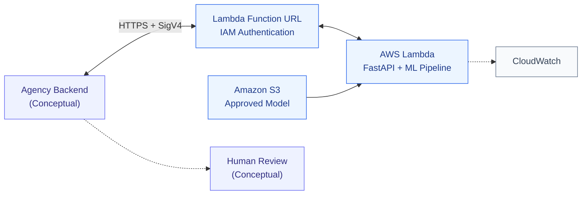
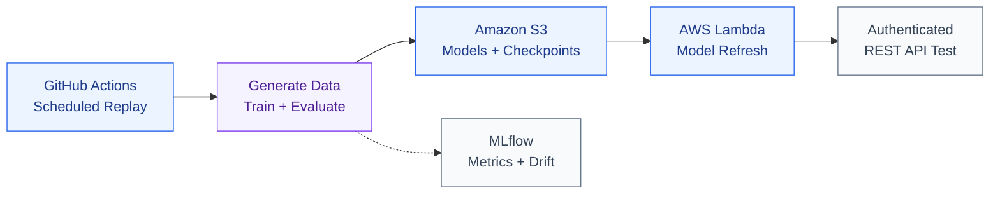

# System Architecture

## 1. Overview and scope

This project demonstrates an MLOps system for fraud-risk screening of financial-assistance applications at a fictional government agency. A scikit-learn model estimates fraud probability through a REST API. The model may flag an application for **human review**; the system does not establish fraud or reject assistance automatically.

The following components are **implemented**: synthetic-data generation, model training and evaluation, FastAPI validation and inference, containerized AWS Lambda service, IAM-protected Lambda Function URL, S3 model/checkpoint storage, GitHub Actions automation, MLflow tracking, drift measurement, and CloudWatch service monitoring.

The agency's applicant portal, internal application database, caseworker review queue, and outage retry process are **conceptual integration points**. No production agency data is ingested; all data in this project is synthetic.

## 2. Online inference workflow

1. **Application submission (conceptual):** An applicant sends an application through the agency's existing portal. The hypothetical agency backend extracts the required screening features and invokes the fraud service. The portal and backend are not implemented in this prototype.
2. **Authenticated request:** The backend would send an HTTPS request signed with AWS Signature Version 4 to the **AWS Lambda Function URL**, which uses AWS_IAM authentication. This architecture does **not** use Amazon API Gateway.
3. **Validation:** The Lambda function hosts FastAPI through Mangum. Pydantic validates the submitted fields: nonnegative monthly_income, positive requested_amount, household_size of at least one, nonnegative previous_applications, and an allowed employment_status. Invalid requests receive validation errors.
4. **Preprocessing and inference:** At initialization, the Lambda service loads the approved joblib model artifact from S3. The saved scikit-learn Pipeline applies the same employment-status one-hot encoding used during training and calculates a fraud probability. A fraud_confirmed label is not required for inference.
5. **Response:** POST /predict returns fraud_probability, flagged_for_review (true when probability is at least the stored threshold), and model_version. GET /health provides a basic availability response; POST /validate validates the request schema.
6. **Review and fallback (conceptual):** The agency backend could retain the prediction and route flagged cases to authorized caseworkers. It could also queue applications for later screening during an outage. Neither the caseworker workflow nor an asynchronous retry mechanism is implemented here.
7. **Service monitoring:** CloudWatch receives AWS Lambda logs and operational metrics, including invocations, errors, and duration. Ordinary API logs do not intentionally print the submitted applicant feature values.

## 3. Offline MLOps workflow

The application container and model artifact have **separate update paths**. A GitHub Actions workflow builds and pushes the FastAPI Lambda image to Amazon ECR when code changes reach main. Updating the Lambda function to a new container image is a separate deployment operation. Monthly model replay **does not rebuild the image**.

### 3.1 Baseline model

The December 2025 baseline uses 2,000 synthetic applications. The baseline training portion contains 1,600 observations, and an initial holdout set supports evaluation. Features are monthly_income, requested_amount, household_size, previous_applications, and employment_status; the synthetic target is fraud_confirmed.

The pipeline uses OneHotEncoder for employment_status and DecisionTreeClassifier(max_depth=3). The stored decision threshold is 0.25. Training reports accuracy, precision, recall, F1, and a confusion matrix; the fitted pipeline, threshold, and version are serialized with joblib.

### 3.2 Scheduled monthly replay

GitHub Actions executes .github/workflows/replay-12-months.yml. The demonstration schedule is currently a five-minute cron expression (`4-59/5 * * * *`), with **one simulated calendar month per execution**. This accelerated replay does not represent real monthly wall-clock intervals. The workflow also supports manual workflow_dispatch.

Scheduled execution requires the GitHub repository variable FRAUD_REPLAY_ENABLED=true. A concurrency group prevents simultaneous replay jobs.

For each successful advancement:

1. **Restore state:** The runner downloads saved checkpoints, the approved model, and MLflow state from isolated S3 replay prefixes. With no previous checkpoint, it initializes the December 2025 baseline.
2. **Generate monthly data:** generate_applications creates 1,000 synthetic applications for the next month from January through December 2026. The 800 training observations are added to cumulative training data; 200 observations form the monthly evaluation set. The cumulative training dataset is embedded in serialized checkpoints rather than uploaded as separate raw monthly datasets.
3. **Measure drift:** The workflow calculates the absolute relative change between that month's mean requested_amount and the reference mean from the initial training data. A change of at least **25%** sets the drift flag. Starting in simulated July 2026, the generator multiplies requested amounts by **1.5** to introduce an artificial distribution shift. Drift is **recorded**; it does not independently trigger retraining.
4. **Train and evaluate:** A candidate pipeline is trained using the cumulative training data. Its F1 score is compared with that of the currently approved model on the same monthly evaluation set. The candidate is promoted only if its F1 score is **strictly greater**; otherwise, the approved model remains unchanged.
5. **Track experiments:** MLflow logs parameters, candidate/current F1 metrics, drift measurements, model-version information, and artifacts. The runner persists the MLflow SQLite database and mlruns artifacts to S3 for restoration on the next execution. No continuously running cloud MLflow server is deployed.
6. **Persist state:** The approved joblib artifact, tracking state, and monthly checkpoint are uploaded to isolated S3 replay prefixes.
7. **Refresh serving model:** GitHub Actions updates Lambda environment variables MODEL_S3_KEY and MODEL_REVISION and waits for the configuration update. The Function URL remains unchanged. Lambda loads the configured approved model from S3 on initialization; this does not require rebuilding or redeploying the ECR image.
8. **Verify serving:** GitHub Actions sends AWS SigV4-signed requests to GET /health and POST /predict. It checks that the response is valid and that the reported model_version matches the approved artifact.

Once checkpoint_2026-12.joblib is present, the workflow skips further monthly advancement. **The schedule itself remains active** until disabled or gated off with FRAUD_REPLAY_ENABLED=false. With 12 completed months, the expected cumulative training size is **11,200 observations** (1,600 initial + 12 × 800); the completed replay must be checked to confirm this.

### 3.3 Persisted replay state

| S3 prefix | Stored objects |
| --- | --- |
| checkpoints/replay-2026/ | Initial and monthly serialized checkpoints, including cumulative training data |
| models/replay-2026/ | Approved fraud_model_approved.joblib serving artifact |
| mlflow/replay-2026/ | MLflow SQLite tracking database and mlruns artifacts |

This replay state is isolated from the original project model artifacts. Training jobs use temporary workspaces on GitHub-hosted runners.

## 4. Monitoring, access control, and failure handling

### 4.1 Monitoring

- **CloudWatch:** Lambda invocation, duration, and error metrics plus service logs. A complete alerting and incident-management system is outside this prototype.
- **MLflow:** Reproducible training parameters, candidate and current F1 results, promotion decisions, model versions, and drift values across replay months.
- **Python drift check:** Univariate monitoring of mean requested_amount against the initial reference mean. This does not measure all forms of data drift or concept drift.

### 4.2 Security and data protection

- The deployed Lambda Function URL uses AWS_IAM authentication. Authorized callers sign HTTPS requests with SigV4.
- GitHub Actions assumes an AWS IAM role using OIDC rather than committing long-lived AWS access keys.
- The Lambda execution role reads explicitly permitted model objects in S3; the GitHub role uses permissions scoped to model, checkpoint, and MLflow paths.
- Only fictional applications are generated. Predictions assist conceptual human review and are not automated determinations of fraud.
- Local development with Uvicorn is separate from the IAM-authenticated cloud endpoint and does not itself provide the AWS Function URL access-control boundary.

### 4.3 Failure handling and limitations

Rejecting a candidate with lower or equal F1 leaves the approved model unchanged. GitHub Actions reports failures in training, persistence, Lambda refresh, or API verification. Stored checkpoints can support manual investigation or recovery.

The system **does not implement atomic deployment transactions or fully automatic rollback** after a partially completed deployment. The agency's proposed review queue and offline retry process are conceptual. Production use would also require real-data validation, fairness assessment, privacy controls, and more comprehensive monitoring.

## 5. Architecture diagrams

### 5.1 Online inference architecture

The agency backend and human review are conceptual; the Lambda Function URL, Lambda/FastAPI service, S3 model storage, and CloudWatch monitoring are implemented.

### 5.2 Offline MLOps architecture

The model refresh path below is distinct from the separate code-image build/push workflow that publishes container images to ECR.

## 6. Reproduction

See the repository [README](../README.MD) for the Python 3.10 environment, baseline training commands, local FastAPI requests, and MLflow UI instructions. Reproducing the optional AWS deployment requires separately configured cloud infrastructure and IAM permissions.
